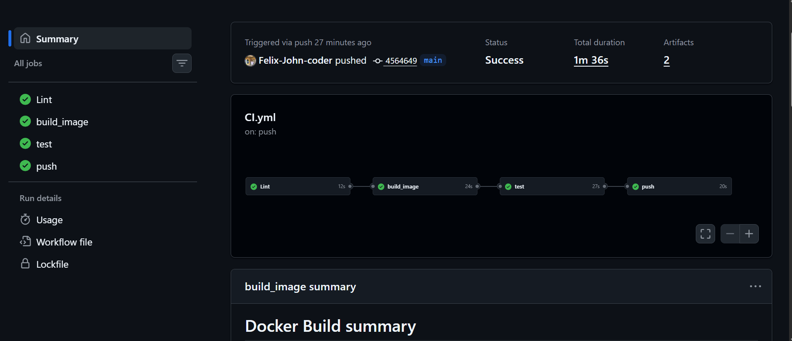

# DevOps Final Assessment

[](https://github.com/Felix-John-coder/devops-final-assessment/actions/workflows/ci.yaml)

**Name:** [FILL IN: your full name]
**Submission date:** [FILL IN: e.g. 2026-11-17]
**Repository:** https://github.com/Felix-John-coder/devops-final-assessment

> Items marked **[FILL IN]** or **[VERIFY]** need your own input or a check against your repo before you submit.

---

## 1. Architecture overview

A web app is built into a container image by CI, published to a registry, deployed by Nomad, registered in Consul for health checking, fronted by a TLS-terminating NGINX, and observed through Loki.

**Delivery pipeline** (source → CI → registry → Nomad):


**Runtime** (request path, health checks, and log path to Loki):


_Diagrams are generated from code: `python3 docs/diagrams/architecture.py` (needs `pip install diagrams` and Graphviz)._

| Component | Role |
|---|---|
| GitHub Actions | CI: [FILL IN: what ci.yaml does, e.g. ShellCheck, image build, push to GHCR] |
| GHCR | Image registry: `ghcr.io/felix-john-coder/devops-final-assessment` |
| Nomad | Schedules the containers via the Docker driver |
| Consul | Service registry and HTTP health checks |
| NGINX proxy | Terminates TLS (self-signed) and forwards to the app |
| Loki + Promtail + Grafana | Log storage, shipping, and querying |

---

## 2. Prerequisites

| Tool | Version | Check with |
|---|---|---|
| Docker | [FILL IN] | `docker --version` |
| Docker Compose | [FILL IN] | `docker compose version` |
| Nomad | [FILL IN] | `nomad version` |
| Consul | [FILL IN] | `consul version` |
| ShellCheck | [FILL IN] | `shellcheck --version` |
| OpenSSL | [FILL IN] | `openssl version` |

Pinned container images used in this repo:

| Image | Version |
|---|---|
| NGINX (app and proxy base) | `nginx:1.27-alpine` (observed `nginx/1.27.5`) |
| Loki | `grafana/loki:3.0.0` [VERIFY: matches your compose file] |
| Promtail | `grafana/promtail:3.0.0` |
| Grafana | `grafana/grafana:11.0.0` |

Environment used: WSL2 (Linux 6.6 microsoft-standard-WSL2) with Docker.

---

## 3. Quick Start

[VERIFY: adjust paths to your actual folders.]

```sh
git clone https://github.com/Felix-John-coder/devops-final-assessment.git      # 1
cd devops-final-assessment
cd monitoring && docker compose up -d && cd ..                                  # 2  Loki, Promtail, Grafana (+ Consul/Nomad if defined there)
nomad job run nomad/nginx.nomad.hcl                                             # 3  web app
docker build -t nginx-tls-proxy:local proxy/                                    # 4  build the TLS proxy image
nomad job run proxy/nginx-proxy.nomad.hcl                                       # 5  proxy
curl -i http://localhost:8080/healthz                                           # 6  app, plain HTTP
curl -ik https://localhost:8443/healthz                                         # 7  app via TLS proxy
curl -s http://localhost:8500/v1/health/checks/nginx-service | grep Status      # 8  Consul check
```

Grafana: http://localhost:3000 (login `admin` / `admin`), then Explore, data source Loki.

---

## 4. Tasks

### Task 1: [FILL IN: title, e.g. Git and repository setup]
[FILL IN: exact commands and observed output.]

### Task 2: [FILL IN: e.g. Shell scripting with ShellCheck]
[FILL IN: exact commands and observed output.]

### Task 3: [FILL IN: e.g. Docker image]
[FILL IN: exact commands and observed output.]

### Task 4: [FILL IN: e.g. CI pipeline (GitHub Actions)]
[FILL IN: what `.github/workflows/ci.yaml` does, and a screenshot of a green run.]



### Task 5: Deployment with Nomad and Consul

Job file: `nginx.nomad.hcl`. The app runs on the host network with a static port, and registers in Consul with a health check on `/healthz`.

```sh
nomad job validate nginx.nomad.hcl
nomad job run nginx.nomad.hcl
curl -i http://localhost:8080/healthz
```

Observed output:

```
HTTP/1.1 200 OK
Server: nginx/1.27.5
Content-Type: text/plain
Content-Length: 2
```

Consul registration and health:

```sh
curl -s http://localhost:8500/v1/catalog/service/nginx-service | grep -E 'ServiceAddress|ServicePort'
curl -s http://localhost:8500/v1/health/checks/nginx-service | grep -E 'Status|Output'
```

Key setting: because Consul and Nomad run as containers while the app uses the host network, the `service` block sets `address = "172.22.0.1"` (the Docker network gateway, i.e. the host) so that Consul checks the address where the app actually listens. See Troubleshooting 1.


[FILL IN: paste your final `"Status": "passing"` output.]


### Task 6: Centralised logging with Loki

Files: `monitoring/docker-compose.yaml`, `monitoring/loki-config.yaml`, `monitoring/promtail-config.yaml`, `monitoring/grafana-datasource.yaml`, and `monitoring/loki_setup.md` (full detail).

Start the stack:

```sh
cd monitoring
docker compose up -d
curl http://localhost:3100/ready
```

Promtail discovers Docker containers carrying the label `logging=promtail` (set in the Nomad job's `labels` block) and attaches these Loki labels:

| Label | Source |
|---|---|
| `job` | Docker label `job` |
| `service` | Docker label `service` |
| `container` | Container name |
| `nomad_alloc_id` | Parsed from the container name (`<task>-<alloc-uuid>`) |

Confirming ingestion:

```sh
curl -s http://localhost:3100/loki/api/v1/labels
```

Observed output:

```
{"status":"success","data":["container","job","nomad_alloc_id","service","service_name"]}
```

(`service_name` is added automatically by Loki 3.x.)

Generate a deliberate 404, then isolate non-200 NGINX access logs in Grafana Explore:

```sh
curl http://localhost:8080/does-not-exist
```

```logql
{job="nginx-app"} | pattern `<ip> - <_> [<_>] "<method> <uri> <_>" <status> <size> "<_>" "<agent>"` | status != "200"
```

[FILL IN: the lines this query returned.]


### Task 6b: Reverse proxy with TLS

Files: `proxy/Dockerfile`, `proxy/nginx.conf`, `proxy/nginx-proxy.nomad.hcl`.

A second NGINX terminates TLS with a self-signed certificate on port 8443 and forwards to the app on `127.0.0.1:8080`. It is registered in Consul as `nginx-proxy`, with an HTTPS check (`tls_skip_verify = true` because the certificate is self-signed).

```sh
docker build -t nginx-tls-proxy:local proxy/
nomad job run proxy/nginx-proxy.nomad.hcl
curl -ik https://localhost:8443/healthz
curl -s http://localhost:8500/v1/health/checks/nginx-proxy | grep -E 'Status|Output'
```

[FILL IN: observed output. Not yet verified: see Known Limitations.]

### Task 7: Documentation
This README.

---

## 5. Troubleshooting

Failures encountered during this project.

### 1. Nomad showed the allocation unhealthy; Consul check "connection refused"

```
Get "http://172.22.0.4:8080/healthz": dial tcp 172.22.0.4:8080: connect: connection refused
```

**Cause:** the app uses `network_mode = "host"`, so it listens on the host's port 8080. Nomad registered `172.22.0.4`, an address on the Docker network where nothing listens on that port. Consul (running in its own container) checked that address and was refused. The app itself was healthy (`curl localhost:8080/healthz` returned 200 from the host).
**Fix:** added `address = "172.22.0.1"` to the `service` block. This is the Docker network gateway, which is the host. Verified first from inside the Consul container: `curl http://172.22.0.1:8080/healthz` returned 200.

### 2. `curl localhost:8080` failed inside the Consul container

**Cause:** `localhost` inside a container is that container itself, not the host.
**Fix:** use the gateway IP (`172.22.0.1`) to reach host-published ports from a container.

### 3. Nomad could not pull the image (IPv6)

```
dial tcp [2606:50c0:8002::154]:443: connect: network is unreachable
```

**Cause:** Docker tried to reach ghcr.io over IPv6 and WSL had no IPv6 route; `force_pull = true` made every deploy re-pull.
**Fix:** set `force_pull = false` to use the local image, or disable IPv6 (`sysctl -w net.ipv6.conf.all.disable_ipv6=1`) and restart Docker.

### 4. Loki rejected log entries with HTTP 400

```
entry too far behind, entry timestamp is: 2026-11-15T17:21:02Z, oldest acceptable timestamp is: 2026-11-16T17:25:46Z
```

**Cause:** when Promtail first attached to the container it read the old backlog, and Loki's `reject_old_samples_max_age` limit refused entries older than the window. New lines were unaffected.
**Fix:** generate fresh traffic and query a recent time range; raise `reject_old_samples_max_age` in `loki-config.yaml` only if old logs are required.

### 5. Loki logged "negative structured metadata bytes received"

**Cause:** not confirmed. It repeated about once per second alongside Promtail pushes. [FILL IN: what you did, e.g. set `allow_structured_metadata: false`, or pinned matching Loki and Promtail versions, and whether it stopped.]

### 6. Image build failed at `apk add openssl`

**Cause:** the build step could not install `openssl`; a standalone `docker run alpine:3 apk update` worked, so the failure was specific to the build. [FILL IN: the fix you used, e.g. `network: host` for the build, or generating the certificate on the host and using `COPY`.]

### 7. Proxy unreachable on port 8443

**Cause:** the `nginx-proxy` container was created in the `monitoring` compose project on the `monitoring_default` bridge network, with no published port (`docker inspect` showed `ports={"80/tcp":null}`). NGINX itself started cleanly.
**Fix:** run it on the host network (`network_mode: host`) so `8443` is reachable and `127.0.0.1:8080` reaches the app. [FILL IN: confirm once working.]

---

## 6. Known Limitations

What is not production-ready, and what I would change with more time:

- **Hardcoded gateway address.** `address = "172.22.0.1"` depends on the Docker network subnet and breaks if the network is recreated. Better: run Consul and Nomad on the host or a shared network and use service discovery or Consul DNS.
- **Self-signed certificate.** Browsers warn, and the Consul check uses `tls_skip_verify = true`. Better: a certificate from an internal CA or Let's Encrypt, with automated renewal, and a verified check.
- **Certificate baked into the image.** The key lives inside the proxy image. Better: inject it from a secrets store such as Vault.
- **Default credentials.** Grafana uses `admin` / `admin`; Loki has no authentication. Better: real credentials from secrets and auth in front of Loki.
- **Single node, no HA.** One Nomad client, one Consul agent in dev-style mode, `count = 1`, no persistence guarantees for Consul or Nomad state.
- **`latest` image tag.** The app image is pulled as `:latest`, which is not reproducible. Better: tag images with the commit SHA from CI.
- **Local-only proxy image.** `nginx-tls-proxy:local` exists only on one machine. Better: build and push it through CI.
- **Promtail.** Promtail is being superseded by Grafana Alloy; a newer setup would use Alloy.
- **Log retention and sizing.** Loki limits (retention, old-sample window) use defaults and were not tuned.
- **Container-in-container Nomad.** Running Nomad itself in a container complicates networking and volume mounts; a host install is more robust.
- [FILL IN: anything specific to Tasks 1 to 4, e.g. CI has no integration tests or deployment step.]

---

## 7. Repository layout

[VERIFY: replace with the output of `tree -L 2 -a -I .git`.]

```
.
├── .github/workflows/ci.yaml
├── nomad/                   (or nginx.nomad.hcl at the root)
├── monitoring/
│   ├── docker-compose.yaml
│   ├── loki-config.yaml
│   ├── promtail-config.yaml
│   ├── grafana-datasource.yaml
│   └── loki_setup.md
├── proxy/
│   ├── Dockerfile
│   ├── nginx.conf
│   └── nginx-proxy.nomad.hcl
├── docs/
│   ├── diagrams/            (architecture.py + generated PNGs)
│   └── screenshots/
└── README.md
```