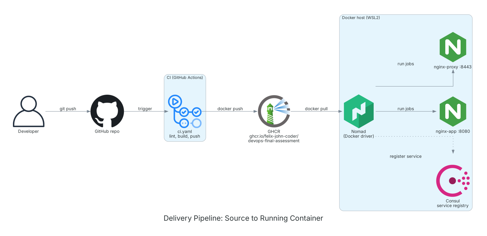
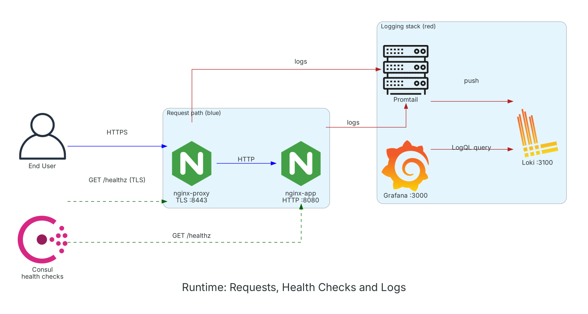
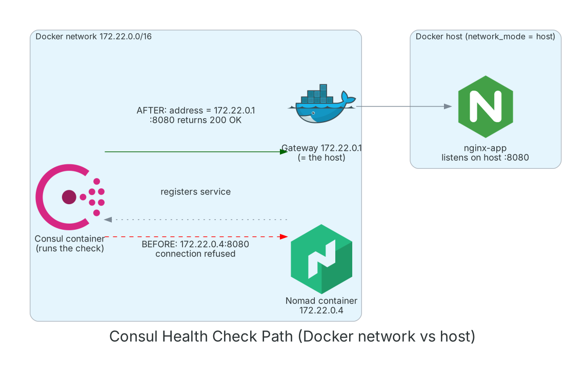
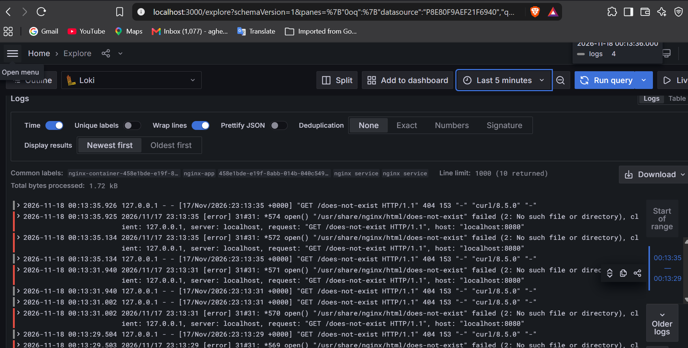

# DevOps Final Assessment


[](https://github.com/Felix-John-coder/devops-final-assessment/actions/workflows/CI.yml)


**Name:** Felix Aghedo  
**Submission date:** 17 December 2026  
**Repository:** [devops-final-assessment](https://github.com/Felix-John-coder/devops-final-assessment)  
**Release:** `v1.0.0`

---

## Architecture Overview

This project implements a containerised application delivery and monitoring workflow.

A developer pushes code to GitHub, triggering GitHub Actions to lint, build, test, and publish the Docker image to GitHub Container Registry (GHCR). HashiCorp Nomad deploys the application and TLS reverse proxy using the Docker driver. Consul handles service registration and health checks, while Promtail collects container logs and forwards them to Loki for visualisation in Grafana.

### Delivery pipeline




### Runtime architecture



### Consul health-check networking



| Component | Purpose |
|---|---|
| GitHub Actions | CI automation |
| GHCR | Container image registry |
| Docker | Container runtime |
| Nomad | Container orchestration |
| Consul | Service discovery and health checks |
| NGINX | Application server and TLS reverse proxy |
| Promtail | Log collection |
| Loki | Log aggregation |
| Grafana | Log querying and visualisation |

---

## Prerequisites

| Tool | Version |
|---|---|
| Docker | 29.2.1 |
| Docker Compose | 5.0.2 |
| Nomad | 2.1.1 |
| Consul | v1.21.5 |


---

## Quick Start

Clone the repository and start the supporting infrastructure:

```bash
git clone https://github.com/Felix-John-coder/devops-final-assessment.git
cd devops-final-assessment

cd monitoring && docker compose up -d && cd ..

docker pull ghcr.io/felix-john-coder/devops-final-assessment:latest

docker exec -i nomad nomad job run  - < nomad/nginx.nomad.hcl

docker build -t nginx-tls-proxy:local ./reverse-proxy

docker exec -i nomad nomad job run - < reverse-proxy/nginx-proxy.nomad.hcl

curl -i http://localhost:8080/healthz
curl -ik https://localhost:8443/healthz
```

Open Grafana at `http://localhost:3000` and navigate to **Explore → Loki** to query application logs.

---

## Task 1 — Source Control

Created and maintained the assessment repository using incremental Git commits and conventional commit messages.

**Conventional commit examples:**

```text
feat: software built 
feat: script updated/added
feat: nomad infra added
ci: ci workflow added
fix: workflow fixed
docs: docs/Readme updated
```

**Verify repository history and release:**

```bash
git log --oneline --decorate
git branch -a
git tag --list
```


Pull request: [devops-final-assessment-closed-pull-request] https://github.com/Felix-John-coder/devops-final-assessment/pulls?q=is%3Apr+state%3Aclosed

---

## Task 2 — Linux Scripting

Implemented two executable shell scripts under `scripts/`.

| Script | Responsibility |
|---|---|
| `sysinfo.sh` | Reports current user, effective UID, hostname, kernel release, ISO-8601 date, disk usage, memory usage, and Docker daemon status |
| `healthcheck.sh` | Sends an HTTP request to a target URL and verifies that the application returns HTTP 200 |

The health-check script accepts a URL argument and defaults to `http://localhost:8080`.

**Run the scripts:**

```bash
./scripts/sysinfo.sh

./scripts/healthcheck.sh
./scripts/healthcheck.sh http://localhost:8080/healthz
```


Both scripts are committed and run in the pipeline with executable permissions.

---

## Task 3 — Containerisation

Built a production-shaped NGINX application image under `app/`.

Implementation includes:

- Pinned NGINX Alpine base image.
- Custom `nginx.conf` serving the application on port `8080`.
- `/healthz` endpoint returning HTTP 200.
- Non-root NGINX execution.
- `EXPOSE 8080` and Docker `HEALTHCHECK`.
- `BUILD_SHA` build argument exposed through the application response.
- Final image designed to remain below 60 MB.


 ### Deployment Reliability

The NGINX application runs as a Nomad service with deployment and recovery policies:

- **Rolling updates:** Controls deployment concurrency and monitors allocation health.
- **Restart and rescheduling:** Automatically retries failed tasks and reschedules unsuccessful allocations.
- **Consul health monitoring:** Uses HTTP health checks on `/healthz` to monitor application availability.

These policies help maintain application availability and recover from task failures.

**Build the image:**

```bash
docker build \
  -t devops-final:local \
  ./app
```

**Inspect image size:**

```bash
docker images devops-final:local
```

**Run the container:**

```bash
docker run -d \
  --name devops-final \
  -p 8080:8080 \
  ghcr.io/felix-john-coder/devops-final-assessment:latest
```

**Test the application:**

```bash
curl -i http://localhost:8080/
curl -i http://localhost:8080/healthz
```

**Observed health-check response:**

```text
HTTP/1.1 200 OK
Server: nginx/1.27.5
Content-Type: text/plain
Content-Length: 2
```

Image size: `20.7MB`

---

## Task 4 — Continuous Integration

Implemented `.github/workflows/ci.yml` using GitHub Actions.

The workflow runs on pushes and pull requests targeting `main`.

| Job | Responsibility |
|---|---|
| `lint` | ShellCheck and Hadolint |
| `build` | Builds the Docker image with `BUILD_SHA` |
| `test` | Starts the container, waits for readiness, and runs `healthcheck.sh` |
| `publish` | Publishes the image to GHCR on pushes to `main` |

The publishing workflow uses `GITHUB_TOKEN` with restricted permissions and publishes both commit-SHA and `latest` image tags.

**Published image:**

```text
ghcr.io/felix-john-coder/devops-final-assessment
```


The CI status badge at the top of this README links to the workflow.

---

## Task 5 — Orchestration with Nomad and Consul

Implemented `nomad/nginx-app.nomad.hcl` to deploy the application using Nomad's Docker driver.

The job includes:

- Service-type deployment with one group and one task.
- GHCR image reference with a parameterised image tag.
- CPU and memory resource allocation.
- Dynamic port allocation using the named `http` port mapped to container port `8080`.
- Consul service registration and HTTP health checks.
- Rolling deployment configuration with automatic rollback.
- Restart and rescheduling policies.

**Validate the job:**

```bash
docker exec -i nomad nomad job validate - <  ../nomad/nginx.nomad.hcl
```

**Plan the deployment:**

```bash
docker exec -i nomad nomad job plan - <  ../nomad/nginx.nomad.hcl
```

**Deploy:**

```bash
docker exec -i nomad nomad job run - <  ../nomad/nginx.nomad.hcl
```

**Inspect deployment status:**

```bash
docker exec -it nomad nomad job status nginx-app
```

The application registers with Consul, which checks `/healthz` every 10 seconds with a 2-second timeout.

**Consul health verification:**

```bash
curl -s http://localhost:8500/v1/health/checks/nginx-service
```

## TLS reverse proxy

An additional NGINX TLS reverse proxy was configured under `reverse-proxy/`.

It terminates HTTPS on port `8443` and forwards application requests to port `8080`.

**Build and deploy:**

```bash
docker build -t nginx-tls-proxy:local ./reverse-proxy

docker exec -i nomad nomad job run - < reverse-proxy/nginx-proxy.nomad.hcl
```

**Verify HTTPS:**

```bash
curl -ik https://localhost:8443/healthz
```

The `-k` option allows testing with the assessment's self-signed certificate.

### Deployment Reliability

The TLS reverse proxy uses Nomad deployment and recovery policies to improve availability:

- **Rolling updates:** One allocation at a time, with automatic rollback on unsuccessful deployments.
- **Restart and rescheduling:** Retries failed tasks and reschedules allocations using exponential backoff.
- **HTTPS health monitoring:** Consul checks `/healthz` every 10 seconds with a 2-second timeout.

These configurations support controlled deployments and automated service recovery.

---

## Task 6 — Log Aggregation with Grafana Loki

Implemented a monitoring stack under `monitoring/` containing:

```text
monitoring/
├── docker-compose.yaml
├── loki-config.yaml
├── promtail-config.yaml
└── loki_setup.md
```

Promtail collects Docker container logs and forwards them to Loki.

The log streams include useful labels:

| Label | Purpose |
|---|---|
| `job` | Workload identification |
| `container` | Container identification |
| `service` | Service identification |
| `nomad_alloc_id` | Nomad allocation identification |

**Start the monitoring stack:**

```bash
cd monitoring
docker compose up -d
```

**Verify Loki ingestion:**

```bash
curl http://localhost:3100/ready
curl -s http://localhost:3100/loki/api/v1/labels
```

**Generate a failed request:**

```bash
curl http://localhost:8080/does-not-exist
```

**Query non-200 application responses in Grafana Explore:**

```logql
{job="nginx-app"}
| pattern `<ip> - <_> [<_>] "<method> <uri> <_>" <status> <size> "<_>" "<agent>"`
| status != "200"
```

This query extracts the HTTP status from NGINX access logs and filters unsuccessful responses.



Additional configuration, queries, observed results, and troubleshooting notes are documented in `monitoring/loki_setup.md`.

---

## Troubleshooting

| Failure | Cause and resolution |
|---|---|
| Consul returned `connection refused` for `172.22.0.4:8080` | The application used host networking. Configured the Consul service address to use the Docker gateway `host.docker.internal`. |
| `localhost:8080` failed inside the Consul container | Container localhost refers to itself. Used the Docker gateway to reach the host application. |
| Nomad failed to pull an image because IPv6 networking was unavailable | Set `force_pull = false` to reuse the image already available in the Docker daemon. |
| Loki rejected old log entries with HTTP 400 | Old buffered entries were outside Loki's accepted timestamp window. Generated fresh requests and queried recent logs. |

---

## Known Limitations

- **Single-node environment:** Nomad and Consul do not have high availability. I would introduce multiple server and client nodes.
- **Host address via `host.docker.internal`:** Consul reaches the host through this name, which depends on the `extra_hosts` entry in the compose file. With more time I would run Consul and Nomad on the host or use Consul DNS, so no host address is needed.
- **Self-signed TLS certificate:** Suitable for local assessment, not public production traffic. I would use a trusted CA and automated renewal.
- **Default monitoring credentials:** Grafana and Loki require stronger authentication and access controls before production use.
- **Manual deployment:** CI publishes the image, but deployment to Nomad is not fully automated. I would introduce an authenticated deployment stage with approval and rollback.
- **Local environment:** The assessment runs on a single WSL2 Docker environment, not a production multi-node infrastructure.

---

## Conclusion

This project demonstrates an end-to-end DevOps workflow covering source control, Linux automation, containerisation, CI/CD, orchestration, service discovery, TLS reverse proxying, and centralised logging.

It also involved troubleshooting practical infrastructure issues involving Docker networking, Nomad image management, Consul health checks, and Loki log ingestion.

**Repository:** [devops-final-assessment](https://github.com/Felix-John-coder/devops-final-assessment)